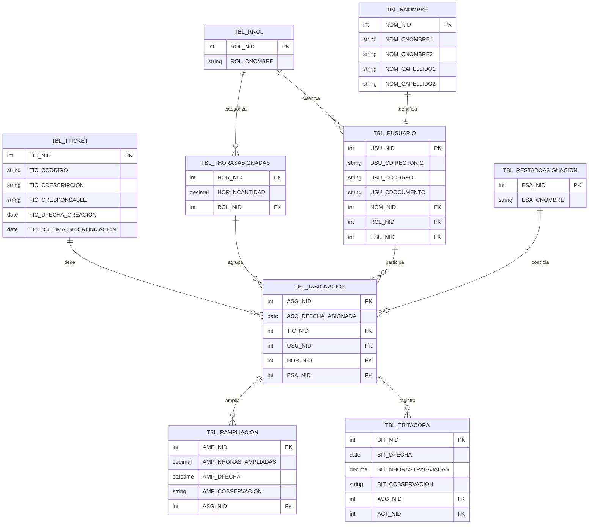

# Bitácora de Actividades

## Descripción

Este proyecto corresponde a una bitácora de actividades para el control operativo de tickets, asignaciones, ampliaciones de horas y usuarios internos. La solución está orientada a registrar y consultar información administrativa de manera organizada, con trazabilidad de horas por categoría y una interfaz web de administración.

La aplicación está construida con una arquitectura cliente-servidor: **HTML, CSS y JavaScript sin framework** en el frontend, y **ASP.NET Core Web API** en el backend, con comunicación mediante API REST.

## Objetivo

Centralizar la información operativa del sistema para facilitar el registro, asignación de horas, ampliación, y seguimiento de tickets entre tres categorías de responsables (Senior, Desarrollo y Calidad), además de la administración de usuarios internos.

## Tecnologías

- **Frontend:** HTML, CSS y JavaScript — sin framework, sin paso de compilación (sin bundler ni transpilador). Cada página es un archivo `.html` independiente.
- **Backend:** ASP.NET Core Web API (.NET 8), organizado en 4 proyectos (Api, Aplicación, Infraestructura, Dominio), con Swagger para explorar los endpoints
- **Base de datos:** SQL Server, acceso vía Dapper y procedimientos almacenados
- **Autenticación:** por cookie, con el usuario validado contra Active Directory (vía un servicio SOAP)
- **Comunicación:** HTTPS con JSON

## Alcance

La aplicación permite:

- consultar y asignar tickets a tres categorías de responsables (Senior, Desarrollo y Calidad), cada una con su propio pool de horas,
- ampliar horas ya asignadas, y completar horas que quedaron pendientes,
- vincular a un ticket tareas creadas desde otro cliente de la API (`Tarea/CrearTarea`),
- cargar tickets masivamente desde un archivo CSV (el responsable de cada ticket queda como Senior),
- registrar y administrar usuarios internos (rol, estado),
- consultar listados, filtrar por estado, y exportar el listado de asignaciones a un CSV que Excel abre directamente.

La API también expone el registro de tiempo trabajado (`Bitacora/RegistrarTiempo` y `Bitacora/RegistrarTiempoTarea`), pero esta interfaz web no tiene pantalla para ello: está pensado para otros clientes.

No incluye:

- registro de usuarios desde la aplicación (se crean automáticamente al iniciar sesión por primera vez, vía Active Directory),
- integración con sistemas externos más allá de Active Directory,
- analítica avanzada,
- inteligencia artificial,
- procesos fuera del contexto administrativo definido.

## Modelo de datos

### Base de datos sugerida

**Nombre sugerido:** `BITACORA_ACTIVIDADES`

### Tablas

| Tabla | Descripción |
|---|---|
| `TBL_RROL` | Catálogo de roles (Administrador, Senior, Desarrollador y Calidad) |
| `TBL_RESTADOUSUARIO` | Catálogo de estados de usuario (Activo/Inactivo) |
| `TBL_RESTADOTICKET` | Catálogo de estados de ticket |
| `TBL_RESTADOASIGNACION` | Catálogo de estados de una asignación (Asignado, Agotado) |
| `TBL_RTIPO` | Catálogo de tipos de ticket |
| `TBL_RETAPA` | Catálogo de etapas |
| `TBL_RETAPAROL` | Relación entre etapas y roles permitidos |
| `TBL_RACTIVIDAD` | Catálogo de actividades por etapa |
| `TBL_RNOMBRE` | Nombres y apellidos de un usuario (separado de sus credenciales) |
| `TBL_RUSUARIO` | Usuarios internos (directorio, correo, rol, estado) |
| `TBL_TTICKET` | Tickets registrados (incluye carga por CSV) |
| `TBL_THORASASIGNADAS` | Pool de horas por categoría (Senior/Desarrollo/Calidad) de un ticket |
| `TBL_TASIGNACION` | Asignación de una persona a un pool de horas |
| `TBL_RAMPLIACION` | Ampliaciones de horas sobre una asignación |
| `TBL_TBITACORA` | Registro de tiempo trabajado |
| `TBL_TCONSULTA_API` | Registro de las peticiones que recibe la API y de sus errores (auditoría) |

Las tablas de **tareas** que usan los procedimientos `SPR_*_TAREA*` no están descritas aquí (ver [Base de datos](#base-de-datos)).

### Campos principales

#### `TBL_RUSUARIO`
- `USU_NID`, `USU_CDIRECTORIO`, `USU_CCORREO`, `USU_CDOCUMENTO`, `NOM_NID` (FK), `ROL_NID` (FK), `ESU_NID` (FK)

#### `TBL_RNOMBRE`
- `NOM_NID`, `NOM_CNOMBRE1`, `NOM_CNOMBRE2`, `NOM_CAPELLIDO1`, `NOM_CAPELLIDO2`

#### `TBL_RROL`
- `ROL_NID`, `ROL_CNOMBRE`

#### `TBL_TTICKET`
- `TIC_NID`, `TIC_CCODIGO`, `TIC_CDESCRIPCION`, `TIC_CRESPONSABLE`, `TIC_DFECHA_CREACION`, `TIC_DULTIMA_SINCRONIZACION`, `TIP_NID` (FK), `ETA_NID` (FK), `EST_NID` (FK)

#### `TBL_THORASASIGNADAS`
- `HOR_NID`, `HOR_NCANTIDAD`, `ROL_NID` (FK) — un registro por categoría (Senior/Desarrollo/Calidad) de cada ticket; `HOR_NCANTIDAD` queda en `NULL` hasta que se le asigna una hora por primera vez. El ticket al que pertenece el pool se conoce a través de `TBL_TASIGNACION`.

#### `TBL_TASIGNACION`
- `ASG_NID`, `ASG_DFECHA_ASIGNADA`, `TIC_NID` (FK), `USU_NID` (FK), `HOR_NID` (FK), `ESA_NID` (FK)

#### `TBL_RAMPLIACION`
- `AMP_NID`, `AMP_NHORAS_AMPLIADAS`, `AMP_DFECHA`, `AMP_COBSERVACION`, `ASG_NID` (FK)

#### `TBL_TBITACORA`
- `BIT_NID`, `BIT_DFECHA`, `BIT_NHORASTRABAJADAS`, `BIT_COBSERVACION`, `ASG_NID` (FK), `ACT_NID` (FK)

#### `TBL_TCONSULTA_API`
- `CON_DFECHA_REGISTRO`, `CON_CMETODO`, `CON_CDATOS_ENTRADA`, `CON_CDATOS_SALIDA`, `CON_CRESULTADO`, `CON_CMSJ_ERROR`

## Relaciones

- Un rol puede asociarse a varios usuarios.
- Un usuario puede recibir varias asignaciones (una por cada ticket/categoría en la que participa).
- Un ticket tiene hasta 3 pools de horas (uno por categoría: Senior, Desarrollo, Calidad); la asignación (`TBL_TASIGNACION`) es la que une al ticket, a la persona y al pool.
- Un pool de horas puede tener varias personas asignadas (comparten las mismas horas).
- Una asignación puede tener varias ampliaciones (historial de horas agregadas).
- La bitácora registra el tiempo trabajado contra una asignación puntual, y cada registro apunta a una actividad.

## Diagrama ER

El diagrama se centra en el flujo principal (usuarios, tickets, horas y asignaciones). Las tablas de catálogo adicionales (`TBL_RESTADOUSUARIO`, `TBL_RESTADOTICKET`, `TBL_RTIPO`, `TBL_RETAPA`, `TBL_RETAPAROL`, `TBL_RACTIVIDAD`) y la de auditoría (`TBL_TCONSULTA_API`) no se incluyen aquí para mantenerlo legible — están listadas en la tabla de arriba.



## Instalación y ejecución

### Requisitos previos

- .NET 8 SDK
- SQL Server (o motor compatible)
- Un servidor web estático simple para el frontend (o IIS)
- Visual Studio o Visual Studio Code
- Certificado de desarrollo HTTPS de .NET (`dotnet dev-certs https --trust`): la cookie de sesión se emite con `Secure` y `SameSite=None`, así que la API debe servirse por HTTPS
- Un servicio SOAP de Active Directory con el contrato descrito en la sección [Active Directory](#active-directory), o tu propia implementación de `IActiveDirectorySoapServicio`

### Backend

1. Abrir `Api/BitacoraActividades.sln` en Visual Studio.
2. Configurar la cadena de conexión y el resto de valores (ver [Configuración del backend](#configuración-del-backend)).
3. Ejecutar la API con el perfil `https`: queda en `https://localhost:7216` y todas las rutas cuelgan de `/Api` (por ejemplo `https://localhost:7216/Api/Rol/ObtenerRoles`).
4. Verificar los endpoints con Swagger (`https://localhost:7216/swagger`).

#### Configuración del backend

`Api/appsettings.json` solo trae valores de ejemplo. **No guardes credenciales reales en el repositorio**: defínelas con variables de entorno o con *user-secrets* (`dotnet user-secrets init` dentro de `Api/` y luego `dotnet user-secrets set "ConnectionStrings:Conexion" "..."`).

| Clave | Qué es | Variable de entorno |
|---|---|---|
| `ConnectionStrings:Conexion` | Cadena de conexión a SQL Server. Acepta texto plano o, si prefieres, cifrada (ver abajo). | `ConnectionStrings__Conexion` |
| `Security:EncryptionKey` | Clave AES de 32 caracteres. Solo hace falta si la cadena de conexión va cifrada. | `Security__EncryptionKey` |
| `Security:EncryptionIV` | Vector de inicialización de 16 caracteres. Solo hace falta si la cadena de conexión va cifrada. | `Security__EncryptionIV` |
| `AutorizacionWidget:*` | Valores de ejemplo reservados; hoy ninguna parte del código los consume. | — |

**Cadena cifrada (opcional).** Si el valor de `ConnectionStrings:Conexion` no contiene `;`, el backend lo trata como Base64 cifrado con AES-256-CBC (relleno PKCS7) usando `Security:EncryptionKey` y `Security:EncryptionIV`. `Encriptar.Cifrado(1, texto)` genera ese valor y `Encriptar.Cifrado(2, valor)` lo descifra. La clave, el IV y la cadena real nunca deben ir en archivos versionados.

#### Active Directory

El inicio de sesión consulta un servicio SOAP de AD. Sus valores de ejemplo son constantes del código y deben ajustarse a tu entorno:

- `Aplicacion/Servicios/ActiveDirectorySoapServicio.cs`: `UrlServicio` (`http://localhost:9081/WSActiveDirectory/ws.asmx`) y `DominioHost` (`tuempresa`).
- `Api/Controllers/UsuarioController.cs`: `DominioNetbios` (`TUEMPRESA`) y la OU autorizada (`OU=Tecnologia`). La misma OU se repite en la política de autorización de `Api/Program.cs`; hay que cambiarla en los dos sitios.
- Los administradores iniciales se definen en el procedimiento `SPR_GI_USUARIO` (lista de ejemplo `TUEMPRESA\admin1..3`). Quien inicia sesión por primera vez se crea con el rol `4` (Calidad); para entrar al front debe ser Administrador.

**Contrato del servicio.** La API envía un `POST` SOAP a `UrlServicio` con la operación `SearchUserAccount` (espacio de nombres `http://tempuri.org/`, cabecera `SOAPAction: "http://tempuri.org/SearchUserAccount"`) y los parámetros `domainHost` y `userAccount`. Espera en `SearchUserAccountResult` los campos `distinguishedName`, `samaccountname`, `mail`, `EmployeeID`, `sn` (apellidos) y `givenName` (nombres); si `distinguishedName` viene vacío, el usuario se considera no encontrado. Para usar otro proveedor de identidad basta con implementar `IActiveDirectorySoapServicio` (un único método, `BuscarUsuarioAsync`) y registrarlo en `Api/Program.cs` en lugar de `ActiveDirectorySoapServicio`.

#### CORS

La política `AllowFrontend` de `Api/Program.cs` permite por defecto el origen `http://127.0.0.1:5500` (Live Server). Agrega el origen desde el que sirvas el front (esquema, host y puerto, sin `/` final).

### Base de datos

1. Crear la base de datos (`BITACORA_ACTIVIDADES` o el nombre que prefieras).
2. Crear las tablas según el modelo de datos de este documento. El repositorio **no incluye el script de creación (DDL)**: las tablas, columnas y relaciones de arriba, junto con los parámetros de cada procedimiento, describen lo necesario.
3. Ejecutar los scripts de la carpeta `SPs BitacoraActividades/` para crear los procedimientos almacenados. Casi todos empiezan con `ALTER PROCEDURE`; en una base de datos nueva cámbialo por `CREATE OR ALTER PROCEDURE`. `SPR_IU_TICKETS_corregido.sql` es necesario para que la carga de CSV asigne automáticamente al Senior (el procedimiento debe devolver el id del ticket).
4. Cargar datos iniciales en los catálogos (ver [Datos mínimos de los catálogos](#datos-mínimos-de-los-catálogos)).

#### Datos mínimos de los catálogos

Valores que el código da por hechos; los nombres son los que esperan las pantallas.

| Tabla | Valores requeridos |
|---|---|
| `TBL_RROL` | `1` Administrador, `2` Senior, `3` Desarrollador, `4` Calidad. La API usa los ids `2`, `3` y `4` para las categorías; el front compara por **nombre** (sin tildes ni mayúsculas): `Administrador` permite el ingreso, y `Desarrollador` y `Calidad` arman las listas de colaboradores. Renombrar un rol rompe esas listas. |
| `TBL_RESTADOUSUARIO` | `1` Activo (más Inactivo). El front compara por el nombre `Activo`. |
| `TBL_RESTADOTICKET` | `1` Abierto (estado inicial) y `2` Cerrado (lo asigna la carga de CSV a los tickets que no vienen en el archivo). El filtro de *Información de Tickets* ofrece además Resuelto y Cancelado. |
| `TBL_RESTADOASIGNACION` | `1` Asignado y `3` Agotado. `4` Por Asignar solo se usa para mostrar el estado calculado de un ticket. |
| `TBL_RTIPO` | `1` para los códigos que empiezan por `RITM` y `2` para el resto |
| `TBL_RETAPA` | Al menos la etapa `1`, que reciben los tickets nuevos |
| `TBL_RETAPAROL` | Pares etapa–rol que pueden trabajar en cada etapa |
| `TBL_RACTIVIDAD` | Actividades por etapa (las usa el registro de tiempo) |

#### Procedimientos de tareas

La API invoca cinco procedimientos de **tareas**, y las tablas que ellos usan, que no forman parte de `SPs BitacoraActividades/`; la pantalla *Asignar Tareas* no funciona hasta crearlos. Esto es lo que la API espera de cada uno:

| Procedimiento | Parámetros | Debe devolver |
|---|---|---|
| `SPR_INS_TAREA` | `@PI_DESCRIPCION`, `@PI_CAMPANA`, `@PI_IDETAPA`, `@PI_IDUSUARIO` | Una fila con `Id` y `Codigo` |
| `SPR_GET_TAREAS_USUARIO` | `@PI_IDUSUARIO` | Filas con `Id`, `Codigo`, `Descripcion`, `Campana`, `Etapa` y `HorasTrabajadas` |
| `SPR_GET_TAREAS_SIN_REFERENCIA` | — | Lo mismo que el anterior y además `Senior` |
| `SPR_UPD_REFERENCIAR_TAREA` | `@PI_IDTAREA`, `@PI_IDTICKET` | Un entero: las filas afectadas |
| `SPR_INS_REGISTRO_BITACORA_TAREA` | `@PI_FECHA`, `@PI_HORASTRABAJADAS`, `@PI_OBSERVACION`, `@PI_IDTAREA` | Un valor booleano |

`SPR_GET_REPORTE_TICKET` y `SPR_IU_USUARIO_LOCAL` están en el paquete, pero la API actual no los invoca.

### Frontend

1. Editar `Front/JS/ApiService.js` y cambiar la constante `API` por la URL real de tu backend (con la configuración anterior: `https://localhost:7216/Api`).
2. Servir la carpeta `Front/` con cualquier servidor estático (o IIS) desde un origen permitido por CORS.
3. Abrir `Login.html` en el navegador.

## Estructura de carpetas

```text
/BitacoraActividades
│
├── Api/
│   ├── Controllers/
│   ├── Middlewares/
│   ├── Program.cs
│   ├── appsettings.json
│   └── BitacoraActividades.sln
│
├── Aplicacion/
│   ├── Configs/
│   ├── Dtos/
│   ├── Interfaces/
│   └── Servicios/
│
├── Infraestructura/
│   ├── Conexion/
│   ├── Repositorios/
│   └── Servicios/
│
├── Dominio/
│   └── Modelos/
│
├── Front/
│   ├── CSS/
│   ├── JS/
│   ├── Imagenes/
│   ├── Login.html
│   ├── Inicio.html
│   └── (resto de páginas)
│
├── SPs BitacoraActividades/
│   └── (procedimientos almacenados)
│
├── VERSION.txt          (historial de cambios del front)
├── .gitignore
└── README.md
```

## Limitaciones conocidas

- El inicio de sesión recibe solo el **nombre de usuario** y lo valida contra el directorio; no verifica contraseña. Úsalo detrás de una red de confianza o sustituye el proveedor de identidad.
- El rol de Administrador y el estado Activo se comprueban únicamente en el front; la API acepta a cualquier usuario autenticado de la OU autorizada.
- Los procedimientos y tablas de tareas, y el script de creación de las tablas, no están incluidos.
- No hay pruebas automatizadas.

## Mejoras futuras

- Agregar roles de acceso más granulares.
- Incorporar auditoría de cambios.
- Exportar reportes a PDF.
- Mejorar dashboards y filtros avanzados.
- Agregar pruebas automatizadas.
- Centralizar las funciones utilitarias del frontend (hoy están duplicadas entre páginas) en un módulo compartido.

## Licencia

Proyecto de uso académico y demostrativo. Su reutilización o adaptación depende de las condiciones definidas por el autor del repositorio.
